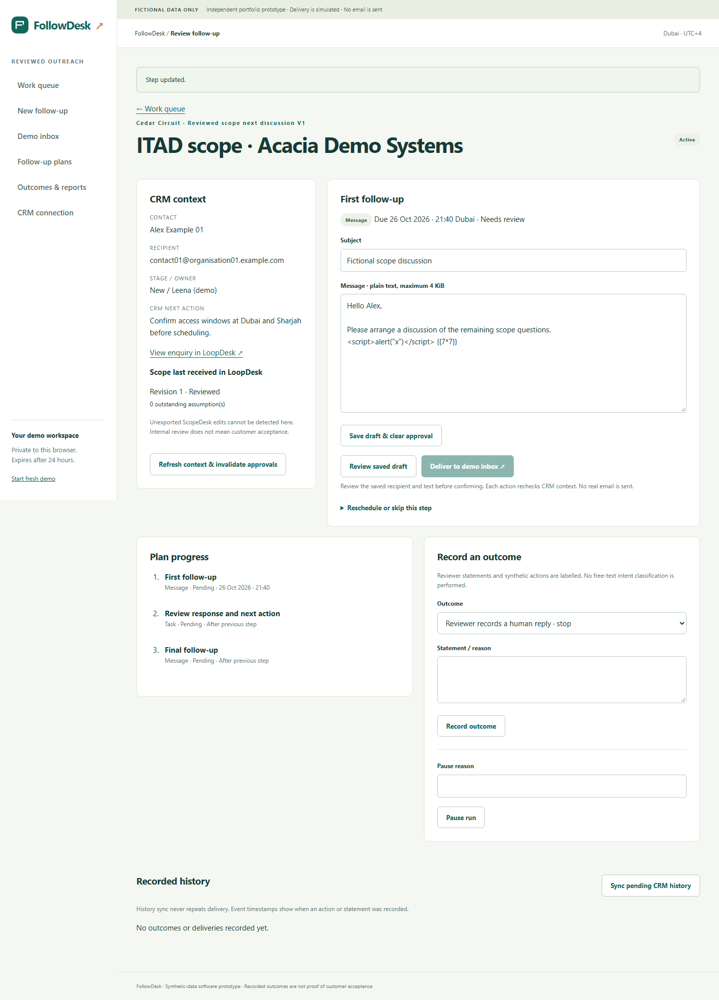

# FollowDesk

Reviewed sales outreach for existing enquiries: pin a follow-up plan, review an exact saved message, deliver to a safe demo inbox, record outcomes and append repeat-safe history to LoopDesk.

**Local preparation checkpoint, 26 October 2026.** This is a synthetic-data portfolio prototype. It is not a production mail system, a company-approved tool or evidence of improved sales performance. No real email, messages, calls or calendar invitations are sent.



## Start locally

Requires the available **Windows x64 / Python 3.14 and Node.js 24** installations. Node's built-in AES-256-GCM encrypts local connection tokens; no npm install or frontend build is needed. Local vault/session keys stay in ignored `instance/` on D:. Do not copy live keys or databases into source archives.

1. Start `D:\codex\loopdesk\Start-LoopDesk.cmd` for the CRM at **http://127.0.0.1:5055**.
2. Optionally start ScopeDesk on **5058** to qualify and import a reviewed scope.
3. Start **`Start-FollowDesk.cmd`** and open **http://127.0.0.1:5059**.
4. Open a private demo, choose **CRM connection**, create a one-use code in LoopDesk and paste it into FollowDesk. Codes expire after five minutes; grants expire after one hour or source workspace expiry.
5. Choose **New follow-up**, select an existing open opportunity and a published plan version. The reviewed-scope plan requires a reviewed scope already imported into LoopDesk.
6. Edit and save the first message. Open its read-only review screen, confirm the exact snapshot and explicitly deliver to the demo inbox.
7. Record a synthetic reply. Pending steps cancel while the delivered receipt remains. Use **Retry pending CRM history** to synchronise outcomes; repeating sync creates no duplicate history.

Each application has its own server, database, cookie and keys. FollowDesk uses `followdesk_session` and a 24-hour private demo. Connected enrolment/review/delivery needs LoopDesk. Local pausing, stopping and recording outcomes remain available during a CRM outage.

All environments, caches, temporary files and artifacts are kept under D:. The launcher installs pinned wheels from `.local/wheels`; it does not install Python or Node. Read the package's verification manifest for the tested environment rather than assuming compatibility with another ABI.

## What is implemented

- Versioned linear plans with up to five message/manual-review steps and a structured editor. Published versions and existing copied steps cannot be changed by editing another version.
- Explicit enrolment against canonical CRM contact/opportunity IDs. Duplicate active contact/destination runs are blocked; case variants enter clarification rather than identity merging.
- Saved-message review proofs bind workspace, step version, recipient, content, schedule and CRM context. Proofs expire after ten minutes. Later edits invalidate approval; unsaved text cannot silently replace an approved message.
- Current-step/due-time checks, explicit rescheduling, reasoned skip, pause/resume with remaining delay, and Active / Paused / Stopped / Completed lifecycle.
- Synthetic replies and reviewer outcomes remain labelled. Replies/meetings/not-interested stop a run; opt-outs also suppress the contact/address and cancel other active matching work. Out-of-office pauses without counting as a human reply.
- Monotonic safety stops can rebase over a just-completed delivery, preventing a race from losing a reply/opt-out. Draft edits still reject stale versions. Reserved bounded audit/event capacity allows safety stops at normal record limits.
- Atomic local mailbox receipt + step transition + durable CRM event. Stable source/event IDs deduplicate CRM retries across reconnects. Lost-acknowledgement recovery is tested over actual local HTTP.
- Event-backed outcome counts, source-linked run history, printable pages and formula-safe CSV.
- Scoped API access cannot create CRM records or alter stage, owner, estimate, next action or tasks.

The queue uses saved context. Approval/delivery recheck live CRM context; unavailable CRM, archived records, closed opportunities or changed context block delivery. This precheck is not an atomic transaction across applications. Scope freshness means **latest revision received by LoopDesk**; an unexported ScopeDesk edit cannot be detected. Internal scope review is not customer approval.

## Verification

```powershell
.venv\Scripts\python scripts\manage.py test
# Start all three apps before the browser journey:
.venv\Scripts\python scripts\manage.py browser
```

`tests/fixtures.json` fixes 32 authored cases: eight valid, eight conflicting, eight boundary and eight security cases. Further tests cover concurrent commands, safe stop propagation, expiry cleanup, source/grant identity, malformed JSON, template injection, API permissions and recovery after a real CRM commit whose acknowledgement is lost.

The full browser story uses actual ScopeDesk → LoopDesk → FollowDesk services and databases. The demo inbox is explicitly a simulation; business responses are not mocked. See [verification](docs/verification.md) and the current JUnit/browser artifacts for actual results. Automated accessibility checks and keyboard/mobile checks do not establish full accessibility conformance. No human five-minute usability study is claimed.

## Hosting status and remaining release gates

**No hosted application is available yet. PostgreSQL and hosted HTTPS are not verified.** Vercel team access works and three independent Flask projects are created and linked. Their verified hostnames and production links are configured. GitHub repositories now exist; source publication is separate from deployment. Database provisioning and protected runtime secrets remain pending; publication authorisation is already recorded.

The repository adapter and migrations include a PostgreSQL path, exercised only after `FOLLOWDESK_TEST_DATABASE_URL` points to a dedicated test database. Production rejects SQLite and missing/placeholder secrets, missing trusted hosts and an absent Fernet vault key. `cryptography` and its dependencies are now pinned, installed offline and tested with the real production vault configuration on Windows, including wrong-key and tampering rejection. The separate local vault continues using Node's standard crypto library. Linux installation and the hosted runtime still require verification; local success does not establish hosted readiness.

Before cloud release: verify the production dependency bundle, provision isolated PostgreSQL, run the same invariants on that backend, configure real HTTPS app addresses/secrets/trusted hosts, verify provider ingress/rate budgets and execute the deployed three-app journey. Full dependency-advisory scanning and production operations remain separate checks.

No CV or application submission is changed by this checkpoint. Use the already proven two-project application unless and until new claims are supported by verification.
