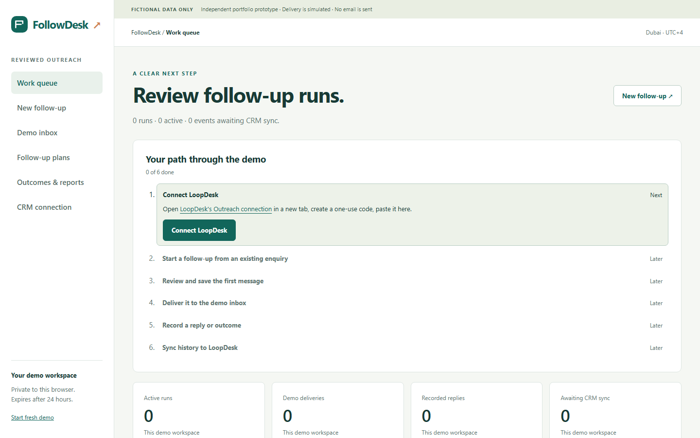
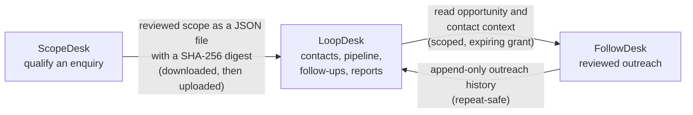

# FollowDesk

Reviewed sales outreach for existing enquiries: pin a follow-up plan, review an exact saved message, deliver to a safe demo inbox, record outcomes and append repeat-safe history to LoopDesk.

**Live demo:** <https://followdesk-phi.vercel.app>. Choose **Open a private demo**; the work queue then walks you through the six steps, starting with pairing to a [LoopDesk demo](https://loopdesk-sigma.vercel.app) (create a one-use code there, paste it here). One of three connected apps: [ScopeDesk](https://github.com/f20230125-sudo/scopedesk) qualifies an enquiry ([live](https://scopedesk-chi.vercel.app)), [LoopDesk](https://github.com/f20230125-sudo/loopdesk) tracks it ([live](https://loopdesk-sigma.vercel.app)) and **FollowDesk** follows up.

[](https://github.com/f20230125-sudo/followdesk/actions/workflows/checks.yml) [](https://github.com/f20230125-sudo/followdesk/actions/workflows/live-smoke.yml)

**Stack:** Python (Flask) and Jinja, a small SQL repository layer with forward-only migrations, SQLite locally and PostgreSQL (Neon) when hosted, Fernet-encrypted CRM grant tokens, no frontend build step. Hosted on Vercel and Neon, both on free plans. Synthetic-data prototype: it is not a production mail system, a company-approved tool or evidence of improved sales performance. No real email, messages, calls or calendar invitations are sent.



## How the three apps fit together

Each app has its own server, database and session cookie. They are joined only by two narrow, explicit contracts.



The scope handoff creates or updates one opportunity and never overwrites CRM fields. FollowDesk's grant comes from a one-use pairing code created in LoopDesk; it cannot create CRM records or change stage, owner, value, next action or tasks.

## Start locally

Requires the available **Windows x64 / Python 3.14 and Node.js 24** installations. Node's built-in AES-256-GCM encrypts local connection tokens; no npm install or frontend build is needed. Local vault/session keys stay in ignored `instance/` on D:. Do not copy live keys or databases into source archives.

1. Start `D:\codex\loopdesk\Start-LoopDesk.cmd` for the CRM at **http://127.0.0.1:5055**.
2. Optionally start ScopeDesk on **5058** to qualify and import a reviewed scope.
3. Start **`Start-FollowDesk.cmd`** and open **http://127.0.0.1:5059**.
4. Open a private demo, choose **CRM connection**, create a one-use code in LoopDesk and paste it into FollowDesk. Codes expire after five minutes; grants expire after one hour or source workspace expiry.
5. Choose **New follow-up**, select an existing open opportunity and a published plan version. The reviewed-scope plan requires a reviewed scope already imported into LoopDesk.
6. Edit and save the first message. Open its read-only review screen, confirm the exact snapshot and explicitly deliver to the demo inbox.
7. Record a synthetic reply. Pending steps cancel while the delivered receipt remains. Use **Retry pending CRM history** to synchronise outcomes; repeating sync creates no duplicate history.

The Work queue now shows **Your path through the demo**, a six-step checklist from the saved workspace records. Only the next unfinished step has a highlighted action. The connection instructions open LoopDesk in a second tab; pairing redirects to **New follow-up** with confirmation. Connection status checks expiry and live access, and explains when LoopDesk cannot be checked. The completed checklist collapses using a native disclosure, including without JavaScript.

Each application has its own server, database, cookie and keys. FollowDesk uses `followdesk_session` and a 24-hour private demo. Connected enrolment/review/delivery needs LoopDesk. Local pausing, stopping and recording outcomes remain available during a CRM outage.

All environments, caches, temporary files and artifacts are kept under D:. The launcher installs pinned wheels from `.local/wheels`; it does not install Python or Node. Read the package's verification manifest for the tested environment rather than assuming compatibility with another ABI.

## What is implemented

- Versioned linear plans with up to five message/manual-review steps and a structured editor. Published versions and existing copied steps cannot be changed by editing another version.
- Each plan step can preview unsaved subject/body text with a fictional sample contact before publication. Preview uses the enrolment renderer, supports all five listed placeholders and `$$`, preserves unsaved fields and publishes nothing. Unknown placeholders are rejected; HTML and executable-looking text remain inert.
- Explicit enrolment against canonical CRM contact/opportunity IDs. Duplicate active contact/destination runs are blocked; case variants enter clarification rather than identity merging.
- Saved-message review proofs bind workspace, step version, recipient, content, schedule and CRM context. Proofs expire after ten minutes. Later edits invalidate approval; unsaved text cannot silently replace an approved message.
- Current-step/due-time checks, explicit rescheduling, reasoned skip, pause/resume with remaining delay, and Active / Paused / Stopped / Completed lifecycle.
- Synthetic replies and reviewer outcomes remain labelled. Replies/meetings/not-interested stop a run; opt-outs also suppress the contact/address and cancel other active matching work. Out-of-office pauses without counting as a human reply.
- Monotonic safety stops can rebase over a just-completed delivery, preventing a race from losing a reply/opt-out. Draft edits still reject stale versions. Reserved bounded audit/event capacity allows safety stops at normal record limits.
- Atomic local mailbox receipt + step transition + durable CRM event. Stable source/event IDs deduplicate CRM retries across reconnects. Lost-acknowledgement recovery is tested over actual local HTTP.
- Event-backed outcome counts, source-linked run history, printable pages and formula-safe CSV.
- Scoped API access cannot create CRM records or alter stage, owner, estimate, next action or tasks.

The queue uses saved context. Approval/delivery recheck live CRM context; unavailable CRM, archived records, closed opportunities or changed context block delivery. This precheck is not an atomic transaction across applications. Scope freshness means **latest revision received by LoopDesk**; an unexported ScopeDesk edit cannot be detected. Internal scope review is not customer approval.

## Verification

```powershell
.venv\Scripts\python scripts\manage.py test
# Start all three apps before the browser journey:
.venv\Scripts\python scripts\manage.py browser
```

`tests/fixtures.json` fixes 32 authored cases: eight valid, eight conflicting, eight boundary and eight security cases. Further tests cover concurrent commands, safe stop propagation, expiry cleanup, source/grant identity, malformed JSON, template injection, API permissions and recovery after a real CRM commit whose acknowledgement is lost.

The full browser story uses actual ScopeDesk → LoopDesk → FollowDesk services and databases. The demo inbox is explicitly a simulation; business responses are not mocked. See [verification](docs/verification.md) and the current JUnit/browser artifacts for actual results. Automated accessibility checks and keyboard/mobile checks do not establish full accessibility conformance. No human five-minute usability study is claimed.

**Local verification, 27 October 2026:** **135 SQLite tests passed** (baseline 89); the expanded three-app journey passed **96 checks** (the original journey had 44), with **32 axe scans and zero automated violations**. The journey also completes FollowDesk enrolment, saved-message confirmation, simulated delivery, synthetic reply, CRM sync and plan preview with JavaScript disabled. New before/after screenshots use `artifacts/2026-10-27-before-*` and `artifacts/2026-10-27-after-*` at 1440×900 and 390×844; the browser result is [2026-10-27-after-browser-verification.json](artifacts/2026-10-27-after-browser-verification.json). The same additions were then verified hosted on PostgreSQL: the three-app journey passed 96 checks against the live origins (32 axe scans, no violations) and the smoke check passed 15/15; see [verification](docs/verification.md). See the [improvement report](artifacts/improvement-report-2026-10-27.md).

## Hosting status and limits

**Hosted** at <https://followdesk-phi.vercel.app> on Vercel's free Hobby plan with a Neon PostgreSQL database on Neon's free plan, separate from the other two apps. See the [deployment runbook](docs/deployment.md). `python scripts/live-smoke.py` checks the hosted app (health, security headers, cookie flags, main pages, 404) and a weekly GitHub Actions workflow runs it; the three-app browser journey can be pointed at the hosted apps (see [verification](docs/verification.md)). Neon suspends an idle database, so the first request after a quiet period can be slower.

The [SQLite and PostgreSQL CI jobs](https://github.com/f20230125-sudo/followdesk/actions/workflows/checks.yml) run the suite on Linux against both databases, including both sides of the actual HTTP integration tests with LoopDesk. Production rejects SQLite and missing/placeholder secrets, missing trusted hosts and an absent Fernet vault key. Pinned `cryptography` dependencies and production Fernet tests pass on Windows and Linux, including wrong-key and tampering rejection. The separate local vault continues using Node's standard crypto library.

The [dependency advisory scan](https://github.com/f20230125-sudo/followdesk/actions/runs/40379579882) checked all 20 pinned runtime/test packages across the three apps, including conditional platform pins, and reported no known vulnerabilities. Its coverage check rejects missing packages. See `artifacts/dependency-audit-verification.json` for scope and timestamp. An advisory scan does not establish production security.

FollowDesk checks LoopDesk live when the work queue or connection page loads (four-second timeout). If LoopDesk is unavailable, pausing, stopping and recording outcomes keep working and the page says the connection could not be checked; delivery and enrolment need LoopDesk.
